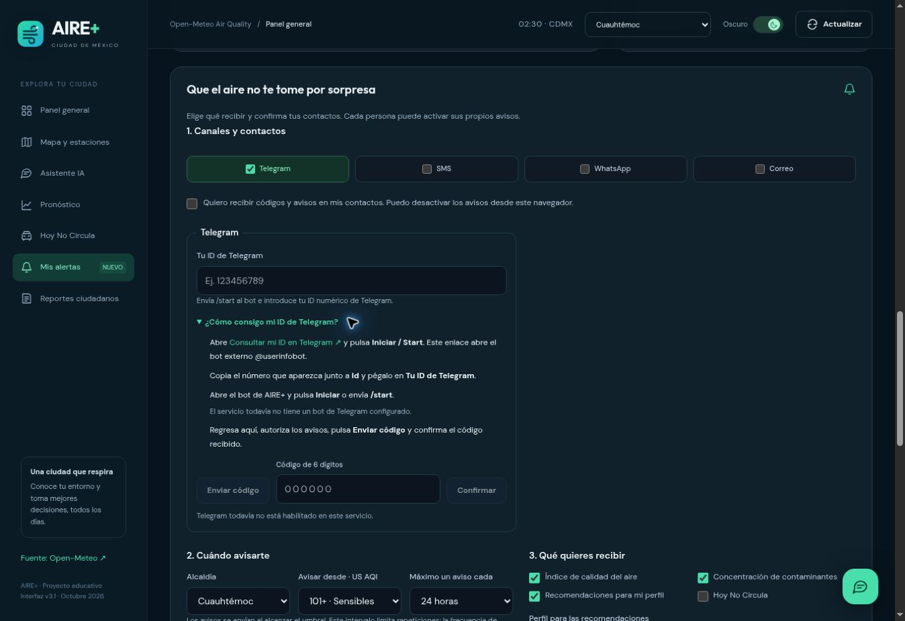

# Configurar Telegram, SMS, WhatsApp y correo en AIRE+

## Qué comprueba la página

**Configurado, sin comprobar** significa que el servidor recibió las variables del canal. **Credenciales comprobadas** significa que Telegram o Twilio aceptaron una consulta de autenticación. La recepción se comprueba después mediante el código enviado a tu contacto.

El botón **Comprobar conexión** consulta Telegram y Twilio sin enviar mensajes. El correo se comprueba solicitando el código: así se verifica también el remitente y la recepción.

## Telegram: obtener el ID del visitante

La tarjeta Telegram incluye la ayuda **¿Cómo consigo mi ID de Telegram?**:

1. Abre [@userinfobot](https://t.me/userinfobot), un bot externo de consulta de ID, y pulsa Iniciar.
2. Copia el número que aparece junto a Id y pégalo en el campo de AIRE+.
3. Abre el bot de AIRE+ con el enlace mostrado en la ayuda y pulsa Iniciar o envíale /start.
4. Autoriza los mensajes, solicita el código y confírmalo.

El enlace al bot de AIRE+ se obtiene automáticamente mediante getMe. El navegador recibe su nombre público y enlace; nunca recibe el token de BotFather. El administrador solo necesita mantener TELEGRAM_BOT_TOKEN configurado en Vercel.

Vista de la ayuda en el entorno local, sin credenciales de producción:

## SMS y WhatsApp: Twilio rechaza las credenciales

El código **20003** indica un rechazo de autenticación o permisos. Primero corrige la combinación de cuenta y token:

1. Abre [la consola de Twilio](https://console.twilio.com/) y selecciona la cuenta que tiene tu número o Sandbox.
2. Copia su **Account SID**, que empieza con AC, y su **Auth Token** real. Usa las credenciales de esa misma cuenta, incluidas las cuentas Trial que permiten envíos de prueba a destinatarios verificados.
3. Evita mezclar las Test Credentials de simulación, una API Key SID que empieza con SK, un token de otra cuenta o el texto enmascarado con asteriscos.
4. En Vercel actualiza TWILIO_ACCOUNT_SID y TWILIO_AUTH_TOKEN en el entorno utilizado.
5. Guarda, vuelve a desplegar y abre el enlace del nuevo despliegue. Un despliegue anterior conserva sus variables anteriores.
6. En AIRE+ pulsa Comprobar conexión. Si las credenciales son válidas, continúa con el código de cada canal.

### Remitentes y destinatarios

| Variable | Contenido |
| --- | --- |
| TWILIO_SMS_FROM | Tu número de Twilio con capacidad SMS, en formato internacional. |
| TWILIO_WHATSAPP_FROM | El remitente aprobado de WhatsApp o número exacto del Sandbox, precedido de whatsapp:. |

Tu celular se introduce como destinatario en AIRE+. Por ejemplo, el formato mexicano es +52 seguido de diez dígitos, sin espacios.

Para SMS, revisa el destinatario permitido y las restricciones de país de tu cuenta Trial. Para WhatsApp Sandbox, envía desde tu WhatsApp el mensaje join con el código que muestre la consola de Twilio. Cada receptor debe unirse al Sandbox.

Fuera de la ventana de atención de WhatsApp se requiere una plantilla aprobada. El proyecto admite TWILIO_WHATSAPP_CONTENT_SID para avisos y TWILIO_WHATSAPP_VERIFY_CONTENT_SID para códigos; revisa el README antes de configurar sus variables.

## Correo electrónico: configuración completa en SendGrid

AIRE+ utiliza la API de SendGrid. La cuenta debe tener acceso al producto de correo, una clave con permiso de envío y un remitente verificado.

### 1. Verifica el correo que enviará los mensajes

1. Entra en [SendGrid](https://app.sendgrid.com/).
2. Abre **Settings → Sender Authentication**.
3. En **Single Sender Verification**, selecciona **Verify a Single Sender**.
4. Completa el formulario con datos válidos. En **From Name** coloca AIRE+. En **From Email Address** coloca el correo que controlarás como remitente. Puedes usar ese mismo correo en Reply To.
5. Pulsa Create.
6. Abre el correo recibido en esa dirección y completa su verificación. Revisa también spam.

El valor de EMAIL_FROM en Vercel debe ser exactamente ese correo verificado. Si ya autenticaste un dominio, utiliza una dirección de ese dominio. SendGrid puede pedir autenticación de dominio o aplicar condiciones a ciertos proveedores de correo; sigue lo que indique tu cuenta.

### 2. Crea una clave con permiso de envío

1. En SendGrid abre **Settings → API Keys → Create API Key**.
2. Asigna el nombre AIRE+.
3. Selecciona acceso personalizado y habilita el permiso de envío de **Mail Send**. Los demás permisos pueden quedar desactivados.
4. Guarda y copia la clave completa. La consola la muestra al crearla; el identificador de la clave no sustituye su valor.

### 3. Agrega dos variables en Vercel

Abre tu proyecto → Settings → Environment Variables:

| Nombre exacto | Valor |
| --- | --- |
| SENDGRID_API_KEY | La clave completa que acabas de crear en SendGrid. |
| EMAIL_FROM | La dirección exacta del remitente que ya verificaste. |

Aplícalas al entorno donde probarás la aplicación: Production y, si lo utilizas, Preview. Guarda los valores privados directamente en Vercel.

### 4. Despliega y comprueba la recepción

1. En Vercel abre Deployments y utiliza Redeploy.
2. Cuando termine, abre el nuevo despliegue.
3. En AIRE+ selecciona Correo y escribe una dirección receptora permitida por tu cuenta.
4. Marca la autorización, pulsa Enviar código y revisa la bandeja de entrada y spam.
5. Copia los seis dígitos y pulsa Confirmar.
6. Activa tus avisos o solicita una prueba.

EMAIL_FROM identifica a quien envía. El correo introducido por el visitante identifica a quien recibe.

### Si el código no llega

| Resultado | Qué revisar |
| --- | --- |
| Correo por configurar | SENDGRID_API_KEY o EMAIL_FROM faltan o no llegaron a ese despliegue. |
| Rechazo 401 | Clave incorrecta, eliminada o de otra cuenta. |
| Rechazo 403 | Permiso Mail Send, verificación del remitente y estado de la cuenta. |
| Aceptado, pero no recibido | Spam, dirección receptora, actividad de correo en SendGrid y restricciones de la cuenta. |

La aceptación del proveedor no equivale a entrega confirmada. No publiques claves ni tokens en GitHub, capturas o mensajes.

## Referencias

- [Bot de consulta de ID](https://t.me/userinfobot)
- [Telegram getMe](https://core.telegram.org/bots/api#getme)
- [Twilio: error 20003](https://www.twilio.com/docs/api/errors/20003)
- [SendGrid: verificar un remitente](https://www.twilio.com/docs/sendgrid/ui/sending-email/sender-verification)
- [SendGrid: claves API](https://www.twilio.com/docs/sendgrid/ui/account-and-settings/api-keys)
- [Vercel: variables de entorno](https://vercel.com/docs/environment-variables/managing-environment-variables)
